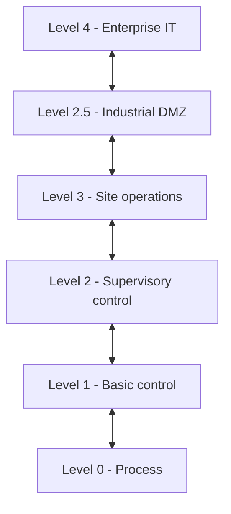

# OT Cybersecurity Labs

**Operational technology | Industrial control systems | IEC 62443 | Purdue model**

This repository represents my structured learning and professional development in OT cybersecurity, building on a broader enterprise infrastructure and network background. It explores how industrial environments differ from traditional IT, and how architecture, segmentation, risk assessment, secure remote access and recovery principles can be considered in an OT context.

**Scope clarification:** these are educational, synthetic and isolated lab materials. They do not claim hands-on production OT security implementation, a certified IEC 62443 assessment or authority to make changes to live industrial systems.

## Learning objectives

- Explain the differences between IT and OT priorities, lifecycles and risk.
- Understand the Purdue Enterprise Reference Architecture conceptually.
- Apply IEC 62443 concepts such as zones, conduits and security levels.
- Explore OT asset inventory, risk assessment and secure remote access.
- Understand monitoring, incident response, resilience and recovery in OT.
- Relate network segmentation and infrastructure security principles to industrial environments.

## Conceptual Purdue-style model

This is a simplified teaching model. Real architectures vary by sector, process, safety requirements and engineering design.

## IEC 62443 concepts explored

| Concept | Practical interpretation |
|---|---|
| Asset owner | Defines business, operational and risk requirements |
| Risk assessment | Identifies threats, vulnerabilities, consequences and risk |
| Zones | Groups assets with common security requirements |
| Conduits | Controls and monitors communications between zones |
| Security levels | Expresses target capability/resistance requirements in context |
| Defence in depth | Uses multiple complementary safeguards |

## Published learning artefacts

- [Synthetic zones-and-conduits case study](case-studies/SYNTHETIC-ZONES-AND-CONDUITS.md)
- [OT risk assessment template](templates/OT-RISK-ASSESSMENT.csv)
- [Secure remote-access design considerations](docs/SECURE-REMOTE-ACCESS.md)
- [OT incident response and recovery notes](docs/OT-INCIDENT-AND-RECOVERY.md)
- [IEC 62443 concept map](docs/IEC-62443-CONCEPT-MAP.md)

## How I approach the subject

The exercises focus on understanding assets and operational consequences first, then considering trust zones, controlled conduits, access paths, monitoring and recovery. In OT, security measures must be evaluated alongside safety, availability, deterministic operation, vendor support and site engineering procedures.

## Safe lab boundaries

- Use simulated systems, training images or isolated virtual environments.
- Never connect a lab to a live production OT network.
- Do not probe, scan, exploit or change configurations on real industrial systems.
- Do not publish real OT asset inventories, network diagrams, process details or vendor remote-access paths.
- Obtain authorisation and follow site safety procedures for any real-world activity.

## Responsible publication

All examples use fictional assets and conceptual designs. They are intended to demonstrate learning and structured security thinking—not production OT experience, certified compliance, or instructions for operating industrial control systems. Refer to current official standards, qualified OT engineers and site-specific safety governance for real projects.
