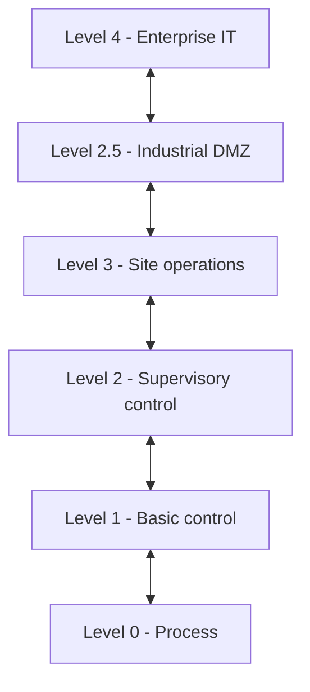

# OT Cybersecurity Labs

**Operational technology | Industrial control systems | IEC 62443 | Purdue model**

A structured learning portfolio focused on the security principles, architecture patterns and risk-management practices used in industrial and operational technology environments.

> These are educational, isolated lab exercises. They are not instructions for interacting with live industrial control systems.

## Learning objectives

- Understand the differences between IT and OT priorities, lifecycles and risk.
- Explain the Purdue Enterprise Reference Architecture at a conceptual level.
- Apply IEC 62443 concepts such as zones, conduits and security levels.
- Understand OT asset inventory, risk assessment and secure remote access.
- Explore monitoring, incident response, resilience and recovery in OT.

## Conceptual Purdue-style model

This is a simplified teaching diagram. Real architectures vary by sector, process, safety requirements and engineering design.

## IEC 62443 concepts

| Concept | Practical interpretation |
|---|---|
| Asset owner | Defines business, operational and risk requirements |
| Risk assessment | Identifies threats, vulnerabilities, consequences and risk |
| Zones | Groups assets with common security requirements |
| Conduits | Controls and monitors communications between zones |
| Security levels | Expresses target capability/resistance requirements in context |
| Defense in depth | Uses multiple complementary safeguards |

## OT risk assessment starter

| Asset / process | Threat scenario | Consequence | Existing controls | Risk / action |
|---|---|---|---|---|
| Synthetic PLC cell | Unauthorized engineering access | Loss of process integrity | Isolated lab, access control | Review access path |
| HMI workstation | Malware introduction | Loss of operator visibility | Allow-listing concept, backups | Validate recovery |
| Historian | Unauthorized data access | Loss of data confidentiality | Segmentation, authentication | Review data flows |

Use fictional assets and qualitative examples only; do not disclose real site or process information.

## Safe lab rules

- Use simulated systems, training images or isolated virtual environments.
- Never connect a lab to a live production OT network.
- Do not probe, scan, exploit or change configurations on real industrial systems.
- Do not publish real OT asset inventories, network diagrams, process details or vendor remote-access paths.
- Obtain authorization and follow site safety procedures for any real-world activity.

## Published learning artefacts

- [Synthetic zones-and-conduits case study](case-studies/SYNTHETIC-ZONES-AND-CONDUITS.md)
- [OT risk assessment template](templates/OT-RISK-ASSESSMENT.csv)
- [Secure remote-access design considerations](docs/SECURE-REMOTE-ACCESS.md)
- [OT incident response and recovery notes](docs/OT-INCIDENT-AND-RECOVERY.md)
- [IEC 62443 concept map](docs/IEC-62443-CONCEPT-MAP.md)

## Roadmap

- [x] Add an OT/IT boundary and industrial DMZ reference design
- [x] Add a zones-and-conduits exercise
- [x] Add a sample OT risk assessment using synthetic assets
- [x] Add secure remote-access design considerations
- [x] Add backup, recovery and incident-response learning notes

These are educational materials, not certified IEC 62443 assessments or instructions for changes to live industrial control systems. Use current official standards, site engineering procedures and safety governance.
