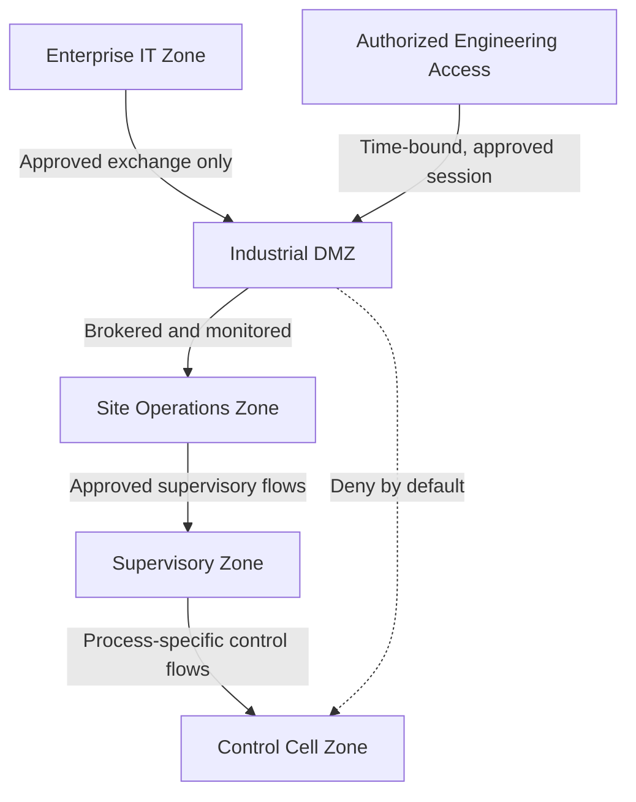

# Synthetic OT Security Case Study — Zones and Conduits

> Educational example only. The facility, process, assets, zones, conduits and risk scenarios are fictional. This is not a deployable industrial network design.

## Scenario

A fictional process facility wants to improve separation between enterprise IT, site operations, supervisory control and basic control assets. The objective is to reduce unnecessary connectivity while preserving required operational data flows and safe engineering support.

## Conceptual zones

| Zone | Example contents | Security intent |
|---|---|---|
| Enterprise IT | Corporate applications and user services | No direct control-system access |
| Industrial DMZ | Approved brokers, jump services, transfer gateways | Controlled boundary and monitored exchange |
| Site operations | Historian services and operations management | Restrict to necessary operational flows |
| Supervisory | HMI and supervisory services | Strong access control and hardened hosts |
| Control cell | PLCs and engineering workstations | Highly restricted, safety-aware access |

## Conceptual communication paths

The diagram expresses a design concept only. Real systems require process engineering, safety review, vendor requirements and detailed risk assessment.

## Conduit requirements

For each conduit, document:
- Source and destination zones
- Business or operational purpose
- Required direction and communication pattern
- Protocol/service requirements validated by engineering
- Authentication and authorization controls
- Monitoring and logging requirements
- Owner, approval, review date and expiry
- Failure behavior and operational impact

## Design principles
1. Deny unnecessary inter-zone communication.
2. Avoid direct enterprise-to-control connectivity.
3. Use controlled, monitored exchange at defined boundaries.
4. Separate engineering access from routine user access.
5. Preserve safety and availability requirements.
6. Validate any security change with OT operations and process-safety stakeholders.

## Validation questions
- Are all assets assigned to an accountable zone?
- Are conduits limited to documented business needs?
- Is remote access approved, time-bound and monitored?
- Are vendor support paths controlled?
- Can operations detect and respond to abnormal communications?
- Have safety and recovery implications been assessed?
